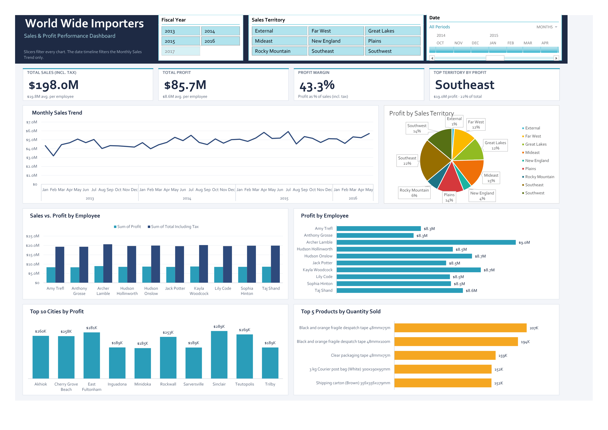

# Wide World Importers: Interactive Sales Dashboard (Excel)

An interactive Excel dashboard that analyses sales and profit for the Wide World Importers dataset. It is built on a Power Pivot data model, so every chart, KPI and filter responds to the same slicers.

## Key figures (all data, no filters applied)

| Metric | Value |
|---|---|
| Total sales (incl. tax) | $198.0M |
| Total profit | $85.7M |
| Profit margin (profit ÷ sales incl. tax) | 43.3% |
| Top territory by profit | Southeast, $19.0M (22% of total profit) |

Sales run from January 2013 to May 2016.

## What the dashboard shows

- **KPI cards:** total sales, total profit, profit margin and top territory. They update with the filters.
- **Monthly Sales Trend:** sales over time, controlled by the date timeline.
- **Profit by Sales Territory:** compares all territories.
- **Sales vs. Profit by Employee:** compares each employee's sales and profit.
- **Profit by Employee:** a ranked view of profit per employee.
- **Top 10 Cities by Profit:** the cities that earn the most profit.
- **Top 5 Products by Quantity Sold:** the best-selling products by units. This chart is limited to the top 10 cities.

## Interactivity

- **Fiscal Year and Sales Territory slicers** filter every chart and KPI.
- **Date timeline** filters the Monthly Sales Trend only.

## Tools and techniques

- **Power Query** to load and shape the source tables
- **Power Pivot (Data Model)** with relationships between fact and dimension tables
- **PivotTables and PivotCharts** as the source for every visual
- **Slicers and a Timeline** for filtering
- **Formula-driven KPI cards** (`INDEX/MATCH`, `SUMPRODUCT`) that read the PivotTables, so they stay in sync with the filters

## Data model

The model uses a star schema with these tables:

`FactSale` (sales facts) connected to `DimCity`, `DimCustomer`, `DimDate`, `DimEmployee` and `DimStockItem`.

**Source:** [add where the data came from, for example the Microsoft Wide World Importers sample database or your course materials]

## How to use

1. Download `World_Wide_Importers_Project_Redesigned.xlsx`.
2. Open it in **desktop Excel** (Windows, Excel 2016 or later). Slicers, timelines and the Data Model need the desktop app, and they do not work in Excel for the web.
3. Go to the **Dashboard** sheet and use the slicers at the top.
4. The `Trend`, `City` and `Employee` sheets hold the PivotTables behind the charts.

## Design notes

- A 12-column grid keeps spacing and alignment consistent.
- The palette is restrained: navy for structure, teal for profit, blue for sales and amber for quantity.
- Large numbers are shown as `$12.8M` and `207K` to keep labels readable.
- Currency is assumed to be US dollars.

## What I learned

- **Data modelling comes first.** Loading the tables with Power Query and linking them in Power Pivot as a star schema (one fact table, several dimension tables) meant every PivotTable and slicer could share the same filters.
- **Slicers and timelines behave differently.** The Fiscal Year and Sales Territory slicers filter every chart, while the date timeline only filters the sales trend. I had to design the layout so that was clear to the viewer.
- **Dashboard design matters as much as the numbers.** I worked on a consistent grid, a limited colour palette, readable number formats (`$12.8M`, `207K`) and flat 2D charts instead of 3D ones, so the dashboard can be understood at a glance.
- **KPI cards need to survive filtering.** Formulas that read the PivotTable totals keep the cards correct when a slicer changes the table, instead of breaking when rows move.
- **Next steps:** I would add year-over-year comparisons and a customer-level view, and publish the model to Power BI.

## Author

[Ivin Ivans] · [https://www.linkedin.com/in/ivin-ivans/]
